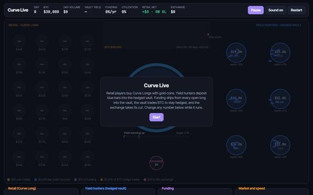
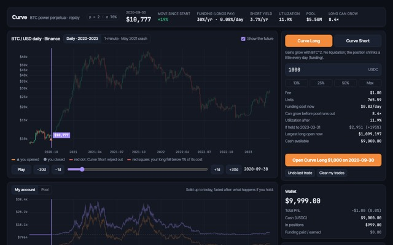
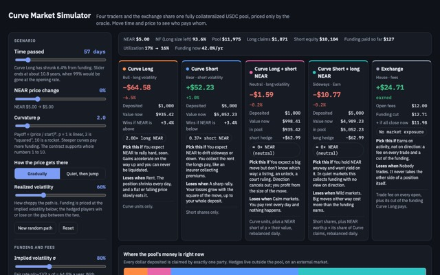
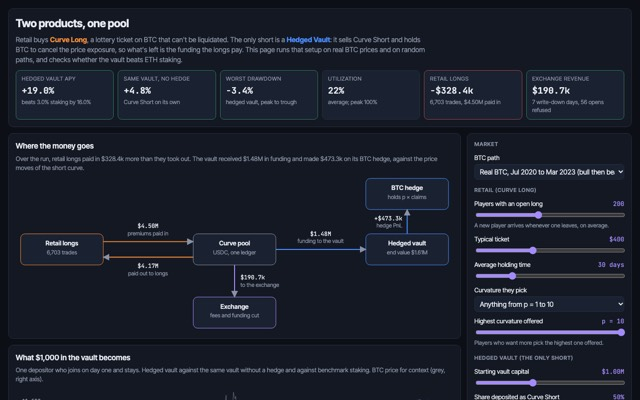
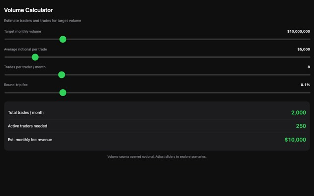
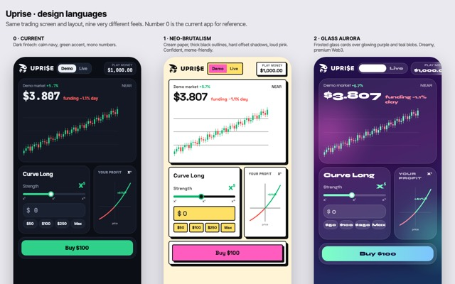
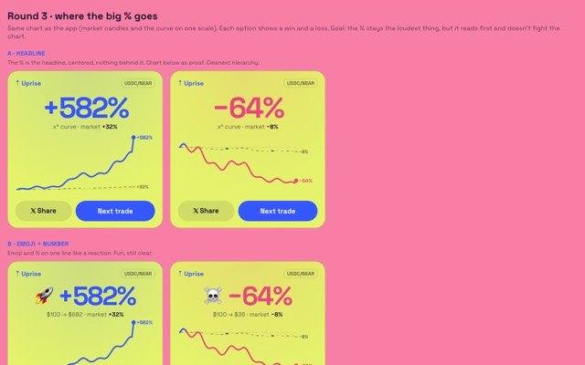
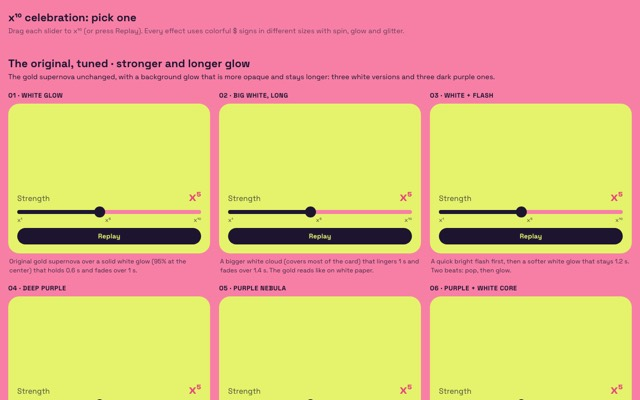

<p align="center"></p>

# Uprise

**Bet on a price rising, with no liquidation.** Uprise is a trading app on NEAR (testnet): you pick how strong your bet is, from x¹ to x¹⁰, and your position grows faster the more the price goes up. A sudden dip can't knock you out. Instead, your position slowly melts over time, so you're betting that the price rises within a time window.

**Try it:** [uprise.wtf](https://uprise.wtf). Start in Demo mode with play money; no wallet needed.

## What it is, in plain words

Uprise has two sides, and they need each other.

### 🐮 Trade: the Curve Long

- **You choose a strength.** x¹ follows the price; x¹⁰ grows ten times as steeply. If NEAR rises 10%, an x³ position is worth about 33% more and an x⁵ about 61% more. This is called a **power perpetual**: the value follows the price to a power.
- **No liquidation.** With normal leverage, a quick drop can close your position and you lose everything, even if the price comes right back. Uprise positions can't be closed by a dip.
- **The price you pay is time.** Instead of a liquidation price, your position has a clock: it melts a little every day (this daily cost is called *funding*). Steeper strengths melt faster. That's why the name says **continuous expiry**: your position never ends on a date, it fades out gradually.

### 🦀 Yield: the vault

- **The other side of every trade.** Liquidity providers deposit USDC into a vault that takes the opposite side of all Curve Longs.
- **It earns what traders pay.** The daily funding that melts the traders' positions flows to the vault.
- **It stays balanced.** The vault holds NEAR alongside its USDC and rebalances automatically, so price moves mostly cancel out. What's left is the funding. This is the same idea as Opyn's "Crab" strategy on Ethereum.

### 📊 Analytics

A live picture of where the yield comes from: traders on the left, the vault in the middle, liquidity providers on the right, and coins flying between them.

## Behind the simple app

It took a lot of math and many experiments to make this feel simple. Everything below can be opened and played with in the browser. The [lab](https://uprise.wtf/lab) collects them on one page.

### Simulators: how the money moves

| | |
|---|---|
| [](https://uprise.wtf/sim/live.html) | **[Live market game](https://uprise.wtf/sim/live.html)**<br>Traders buy curves with gold coins, liquidity providers fill the vault, and funding drips from traders into the vault. Change any number while it runs. |
| [](https://uprise.wtf/sim/btc-replay.html) | **[Replay real history](https://uprise.wtf/sim/btc-replay.html)**<br>Open a Curve Long on any day of Bitcoin 2020–2023 and fast-forward to see what it would have paid. |
| [](https://uprise.wtf/sim/curve-simulator.html) | **[Who pays whom](https://uprise.wtf/sim/curve-simulator.html)**<br>Four traders and the exchange share one pool. Move time and price and watch where every dollar goes. |
| [](https://uprise.wtf/sim/two-sided-vault.html) | **[When does the vault earn?](https://uprise.wtf/sim/two-sided-vault.html)**<br>The two products in one pool, and when the yield vault makes money: when fees are above the volatility that really happens. |
| [](https://uprise.wtf/sim/volume-calculator.html) | **[Volume calculator](https://uprise.wtf/sim/volume-calculator.html)**<br>How many traders and trades it takes to reach a trading volume, and what fees that brings. |

### Design studies: how it should feel

| | |
|---|---|
| [](https://uprise.wtf/styles.html) | **[17 design languages](https://uprise.wtf/styles.html)**<br>The same screen as neo-brutalism, glass, terminal, 8-bit, iOS liquid glass, screen print and more. Number 15 became the app. |
| [](https://uprise.wtf/result-designs.html) | **[Result cards](https://uprise.wtf/result-designs.html)**<br>Three rounds of designs for the card after a trade. |
| [](https://uprise.wtf/particles.html) | **[The x¹⁰ celebration](https://uprise.wtf/particles.html)**<br>Particle effects for maxing out the slider, on a screen that is already full of color. |

### Research and models

- **[Reading list](docs/RESEARCH.md):** the papers Uprise builds on (power perpetuals, everlasting options, perpetual pricing), each with a plain-language note on why it mattered.
- **[Monte Carlo search for all ten strengths](sim/buckets/README.md):** thousands of simulated NEAR years to pick the fees, caps and settings for x¹–x¹⁰ that keep the vault healthy. x¹ pays a small base fee, and steeper strengths pay progressively more.
- **[Earlier Monte Carlo](sim/MONTECARLO.md):** why a Curve Long is a lottery ticket and the vault is insurance.

## How it works under the hood

For the technically curious; you don't need this to use the app.

- **Value of a position:** `NF × (P / P_ref)^p`. P is the NEAR price, p the strength (1–10), and NF a factor that shrinks continuously. That shrinking is the funding.
- **Funding per strength, per year:** `(p(p−1)/2 · σ² · mult_p + base) · m(u)`.
  - `σ` is the market's volatility (the higher of a floor and what the oracle actually measured).
  - `mult_p` is a surcharge that grows with p.
  - `m(u)` rises as more of the vault is in use.
- **Solvency:** all positions share one pool. If traders' claims ever exceeded the pool, everyone would be paid pro rata, so the contract can never owe more than it holds.
- **Gas-free for new users:** the app can create a wallet on your device, and Uprise pays the transaction fees through NEAR's meta-transactions (NEP-366). People who already use NEAR can connect Meteor, MyNearWallet or Intear instead.

| Folder | What's in it |
|---|---|
| [`contract/`](contract) | The market contract (Rust, near-sdk 5): ten strength buckets, funding, the shared pool. 75 tests. |
| [`vault/`](vault) | The 🦀 vault contract: deposits and withdrawals, hedging with wNEAR. 19 tests. |
| [`mock-ft/`](mock-ft), [`mock-swap/`](mock-swap) | Testnet stand-ins for USDC, wNEAR and a swap. |
| [`app/`](app) | The web app and its small server. See [`app/README.md`](app/README.md). |
| [`ops/`](ops) | Testnet deployment, the keeper (price feed, vault hedging, gas top-ups) and test bots. See [`ops/README.md`](ops/README.md). |
| [`deploy/`](deploy) | How it runs on the server behind uprise.wtf. See [`deploy/README.md`](deploy/README.md). |
| [`intents/`](intents) | NEAR Intents (1Click) client for cross-chain deposits. |
| [`sim/`](sim) | The simulators and Monte Carlo models above. |
| [`docs/`](docs) | The research reading list. |
| [`archive/`](archive) | Older plans from earlier stages of the project. |

## Run it yourself

```bash
cargo test --workspace
```

```bash
RUSTC=$(rustup which rustc) RUSTFLAGS="-C link-arg=-s -C target-cpu=mvp" rustup run stable cargo build --workspace --target wasm32-unknown-unknown --release
```

```bash
cd ops && npm install && node keeper.js
```

```bash
node app/server.js
```

Then open `http://localhost:8787`. The testnet accounts and contracts are listed in [`ops/README.md`](ops/README.md).

## License

Proprietary, all rights reserved. You may read this code, and hackathon judges may run it to evaluate it; any other use needs written permission. See [LICENSE](LICENSE).
